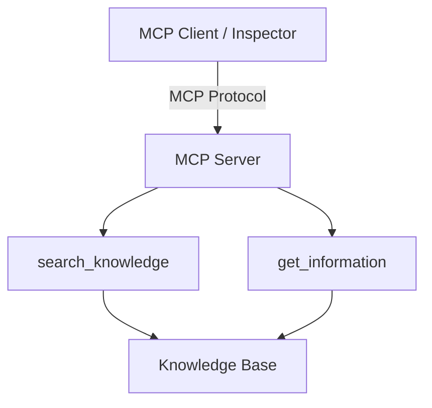

# MCP Server 实验架构说明

## 1. 项目概述

本项目基于 Python 和 MCP（Model Context Protocol）协议构建一个简单的 MCP Server，用于探索 AI 应用如何通过标准化协议调用外部工具与获取信息。

当前实验实现了一个简单的知识查询服务，提供知识搜索和主题信息查询两项工具。

## 2. 系统架构

本实验采用 MCP Client 与 MCP Server 分离的架构。

### 核心组件

- **MCP Client**：负责连接 MCP Server，并发现、调用其提供的工具。
- **MCP Server**：通过 MCP 协议向客户端提供工具服务。
- **Tools**：定义具体的功能，包括知识搜索和主题查询。
- **Knowledge Base**：存储实验中使用的模拟知识数据。

## 3. 工具功能

### search_knowledge

根据关键词搜索知识库中的相关内容。

### get_information

根据指定主题获取对应的详细信息。

## 4. 通信方式

本实验使用 STDIO（标准输入输出）作为 MCP Server 的通信方式。

客户端与服务器通过标准输入和标准输出传递 MCP 协议消息，不需要通过传统 HTTP 接口进行通信。

## 5. 技术栈

- Python
- MCP Python SDK
- FastMCP
- STDIO

## 6. 实验目标

- 理解 MCP Server 的基本架构
- 掌握 MCP Tool 的定义方式
- 理解 MCP Client 与 Server 之间的通信机制
- 为后续多工具、多 Server 及 AI Agent 应用开发打下基础
